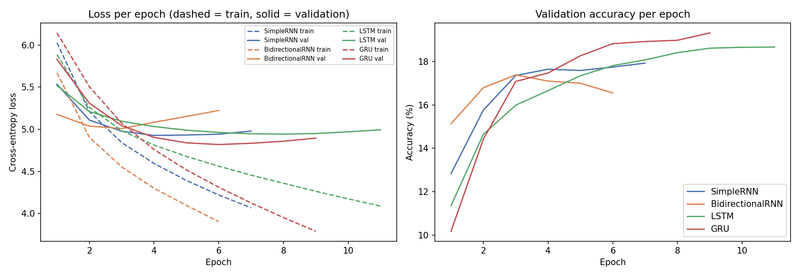
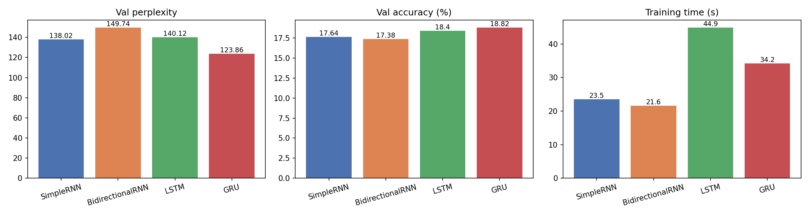
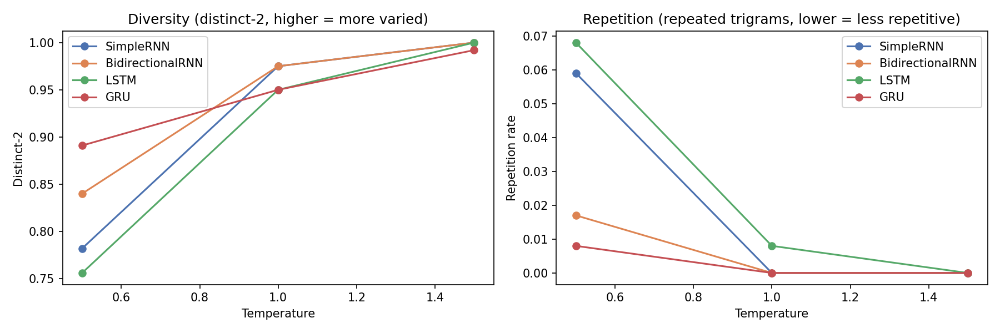

# Autoregressive Text Generation with Simple RNN, Bidirectional RNN, LSTM and GRU

Foundations of Generative AI (ICT4403) — Assignment 2

## Problem statement and objective
Build a word-level **autoregressive** text generator: a model that reads a window of previous words, predicts the
next word, appends it, and repeats to write text. Four recurrent architectures — **Simple RNN, Bidirectional RNN,
LSTM and GRU** — are trained under identical conditions on the same dataset and compared on loss, perplexity,
accuracy, training time and the quality of their generated text at three sampling temperatures.

## Dataset
* **Name:** The Adventures of Sherlock Holmes — Arthur Conan Doyle (Project Gutenberg eBook #1661)
* **Source link:** https://www.gutenberg.org/cache/epub/1661/pg1661.txt
* **Characteristics:** 562,213 characters, 105,863 words, 7,817 unique words,
  about 7,291 sentences (≈14.52 words per sentence). It is a
  collection of 12 short detective stories in late-19th-century English prose, first-person narration by Dr. Watson,
  with frequent dialogue, long sentences and a rich vocabulary.

### Preprocessing
1. Removed the Project Gutenberg licence header/footer.
2. Lower-cased the text and normalised curly quotes.
3. Tokenised into words, keeping `. , ! ? ;` as separate tokens (120,883 tokens used).
4. Kept the 5000 most frequent tokens (covering 97.4% of the text); rarer words → `<unk>`.
5. Built input–target pairs with a sliding window: 10 words in → the next word as target.
6. Split by position: first 90% for training (108,784 sequences), last 10% for validation (12,079 sequences).

## Models implemented
All models: `Embedding(100) → recurrent layer (128 units) → Dropout(0.2) → Dense(5000, softmax)`.

| Model | Recurrent layer | Idea |
|---|---|---|
| Simple RNN | `SimpleRNN(128)` | One hidden state updated word by word; struggles to remember far-back words (vanishing gradients). |
| Bidirectional RNN | `Bidirectional(SimpleRNN(128))` | Reads the input window forwards and backwards and concatenates both summaries. It only sees the input window, never the target word. |
| LSTM | `LSTM(128)` | Gates (input, forget, output) and a cell state let it decide what to keep, so it holds longer context. |
| GRU | `GRU(128)` | Simplified gated cell (update and reset gates); fewer parameters than LSTM. |

**Identical training setup:** Adam (lr = 0.002), sparse categorical cross-entropy, batch size 256,
up to 12 epochs with early stopping (patience 3 on validation loss, best weights restored), seed 42.

## Execution steps
1. Open `FGAI_Assignment2_TextGeneration.ipynb` in Google Colab (or Jupyter).
2. In Colab choose *Runtime → Change runtime type → T4 GPU*.
3. *Runtime → Run all.* The dataset downloads automatically; all outputs are written to `results/` and `plots/`.

### Dependencies
`python>=3.9`, `tensorflow>=2.12`, `numpy`, `pandas`, `matplotlib` (see `requirements.txt`).

## Results
| Model | Parameters | Epochs run | Train loss | Val loss | Train perplexity | Val perplexity | Val accuracy (%) | Val top-5 accuracy (%) | Training time (s) | Time per epoch (s) |
|---|---|---|---|---|---|---|---|---|---|---|
| SimpleRNN | 1174312 | 7 | 4.0675 | 4.9274 | 58.41 | 138.02 | 17.64 | 38.72 | 23.5 | 3.36 |
| BidirectionalRNN | 1843624 | 6 | 3.9037 | 5.0089 | 49.59 | 149.74 | 17.38 | 38.21 | 21.6 | 3.6 |
| LSTM | 1262248 | 11 | 4.0882 | 4.9425 | 59.63 | 140.12 | 18.4 | 39.59 | 44.9 | 4.08 |
| GRU | 1233320 | 9 | 3.79 | 4.8191 | 44.26 | 123.86 | 18.82 | 41.05 | 34.2 | 3.8 |

**Perplexity** = e^(loss): roughly how many words the model is choosing between at each step (lower is better).
**Top-5 accuracy** counts a prediction as correct if the true word is among the model's 5 most likely words.




## Model comparison and evaluation
* **Perplexity / loss:** the gated models (LSTM, GRU) reached an average validation perplexity of 132.0,
  versus 143.9 for the two Simple-RNN-based models. Best: **GRU** (123.86).
* **Accuracy:** GRU predicts the exact next word 18.82% of the time
  (top-5: 41.05%).
* **Training time:** fastest was BidirectionalRNN (21.6 s). On GPU, LSTM and GRU use
  optimised cuDNN kernels; the Bidirectional RNN runs two RNNs, so it costs about twice a Simple RNN.
* **Generated text (qualitative):** Simple RNN and Bidirectional RNN produce locally plausible word pairs but lose the
  thread quickly and drift between topics. LSTM and GRU keep grammatical structure and the story's style
  (dialogue, "said he", "my dear watson"-like phrasing) for longer spans, i.e. better coherence and contextual
  consistency. At low temperature all models fall into loops; gated models do so less.
  Full samples: [`results/generated_samples.txt`](results/generated_samples.txt).

### Example generations (seed: "sherlock holmes sat in his chair and looked at the")
| Model | Temperature | Generated |
|---|---|---|
| SimpleRNN | 0.5 | other side, which he had a long man, however, said holmes, whispered, and the door was a few minutes, and the second, sir, and, for you are not, for the |
| SimpleRNN | 1.0 | papers that we has had bear a friend, who do, then, more for her day; and he was fee all to take mr. inspector, and occasionally thrown into the ground and rising into my |
| SimpleRNN | 1.5 | fleet pool which was frequently to hosmer limbs as alice, and fancies? he began locked my murmured and the lawyer sprang idea round pattered words as fro to noble see, fluttered losing arrested from be she wish |
| BidirectionalRNN | 0.5 | door and in the street. i was not the last life of the city. i have a small chance of the ground, and i knew that the matter was a very one of the papers. the |
| BidirectionalRNN | 1.0 | twice who chalk finds place street. in the ceremony. prick scala holmes died increased up the bedroom, largest later and fell up a small sneer of strength and jet down in our details, the previous assistant |
| BidirectionalRNN | 1.5 | man over his age. accent cleared glancing affairs for the expression hard retired for a gold pale misfortune fellow came fiercely miss lestrade and no hair of your earth would invent in every poor rabbi and come indoors foresight |
| LSTM | 0.5 | door, and that the police are better, but i can not so much, and i think that i had not so. ' said he, yes, that is a very interesting end. it is |
| LSTM | 1.0 | papers that, and yet the honour and a long west laugh had made on the moment when, and i was with no doubt they wish to be not only to ask you. there is hot figure, |
| LSTM | 1.5 | heavy sunk loudly nose; between double intellectual were box and emerald beds, months plate, because 'the well shot many rogue pluck quickly away along forever and decoyed the main whom and is passing some weight and better |
| GRU | 0.5 | corner of his chin, and the inspector was a cold, and i saw the noble carriage, and that the lady was a pale as a noble strong face of a single wooden features, and then, |
| GRU | 1.0 | inner employ of questioning either four. the guilty just rest, i were rich not to say, said he for a nature, and he left me the horse are about. he was a magnificent face of |
| GRU | 1.5 | commonplaces that parted notes monday in misfortune admit a dressed gates. speaking itself for losing our hurry and carrying his armchair projecting was nervous colonel changed the remainder of no time. most others rush it is yours unless |

## Sampling-temperature analysis
Temperatures tested: [0.5, 1.0, 1.5]. Diversity and repetition are measured on the generated words:
**distinct-n** = unique n-grams ÷ total n-grams (higher = more varied), **trigram repetition** = share of repeated
3-word sequences (lower = less repetitive).

| Model | Temperature | Distinct-1 | Distinct-2 | Trigram repetition |
|---|---|---|---|---|
| SimpleRNN | 0.5 | 0.442 | 0.782 | 0.059 |
| SimpleRNN | 1.0 | 0.692 | 0.975 | 0.0 |
| SimpleRNN | 1.5 | 0.867 | 1.0 | 0.0 |
| BidirectionalRNN | 0.5 | 0.475 | 0.84 | 0.017 |
| BidirectionalRNN | 1.0 | 0.692 | 0.975 | 0.0 |
| BidirectionalRNN | 1.5 | 0.833 | 1.0 | 0.0 |
| LSTM | 0.5 | 0.425 | 0.756 | 0.068 |
| LSTM | 1.0 | 0.65 | 0.95 | 0.008 |
| LSTM | 1.5 | 0.875 | 1.0 | 0.0 |
| GRU | 0.5 | 0.533 | 0.891 | 0.008 |
| GRU | 1.0 | 0.633 | 0.95 | 0.0 |
| GRU | 1.5 | 0.817 | 0.992 | 0.0 |

Average over all models:

| Temperature | Distinct-1 | Distinct-2 | Trigram repetition |
|---|---|---|---|
| 0.5 | 0.469 | 0.817 | 0.038 |
| 1.0 | 0.667 | 0.962 | 0.002 |
| 1.5 | 0.848 | 0.998 | 0.0 |



* **T = 0.5 (low):** the model almost always picks its top words → most grammatical and coherent locally, but
  lowest diversity and highest repetition (phrases like "the the", "i have no doubt" loops).
* **T = 1.0 (medium):** samples from the model's actual probabilities → the best balance of coherence and variety.
* **T = 1.5 (high):** flattened probabilities → highest diversity and least repetition, but rare and unrelated words
  appear and sentences lose coherence.

So temperature trades **coherence** (low T) against **diversity** (high T); T ≈ 1.0 is the most useful setting here.

## Conclusion
**GRU** gives the most effective autoregressive generation for this dataset: it has the lowest validation
perplexity (123.86) and loss (4.8191), and its text stays coherent and on-style for
longer than the Simple RNN and Bidirectional RNN, which suffer from short memory. Gated architectures (LSTM/GRU) are
clearly better suited to next-word generation than plain RNNs, and a sampling temperature around 1.0 gives the best
balance between coherent and varied output.

## Repository structure
```
├── FGAI_Assignment2_TextGeneration.ipynb   # full implementation
├── README.md
├── requirements.txt
├── results/   metrics.csv, histories.json, dataset_stats.json,
│              generated_samples.txt/.csv, generation_quality.csv
└── plots/     training_curves.png, model_comparison.png, temperature_effect.png
```
